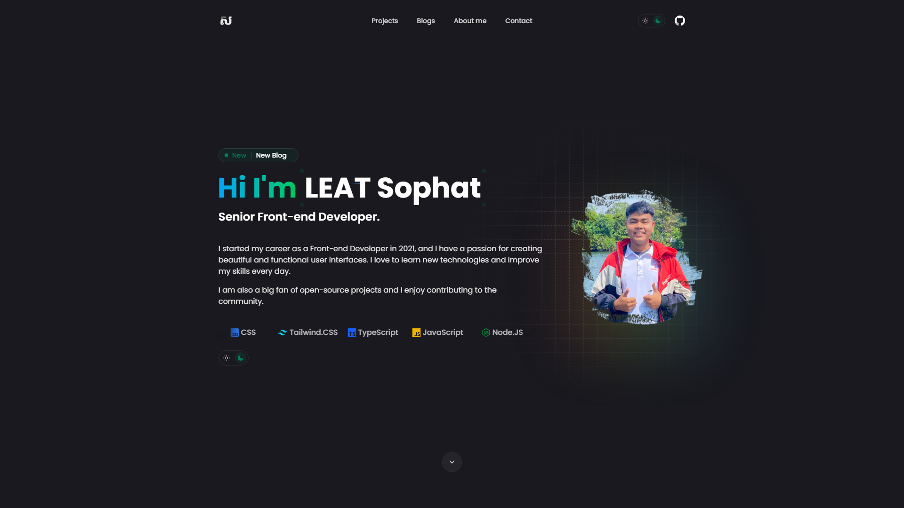

# pphat.me

[](https://pphat.me)

Source code for **[pphat.me](https://pphat.me)**, the personal portfolio and blog of LEAT Sophat, a senior front-end developer and UI/UX designer.

The site has an introduction, a tech stack, work experience, projects, and blog posts. Projects and posts come from a separate API at `api.pphat.me`. The site is built with Next.js and runs on Cloudflare Pages.

## Pages

| Route | What's there |
| --- | --- |
| `/` | Introduction, tech stack, featured projects, experience |
| `/about` | Background and work history |
| `/projects`, `/projects/[slug]` | Project list and project detail pages |
| `/posts`, `/posts/[slug]` | Blog list and articles (Markdown) |
| `/contact` | Contact form (email sent through Resend) |

## Tech stack

- **Next.js 16** (App Router), **React 19**, **TypeScript** (strict)
- **Tailwind CSS v4**, Radix UI, Framer Motion, `next-themes` (light/dark)
- **react-markdown** with `remark-gfm`, `rehype-highlight`, and `rehype-sanitize` for article content
- **Cloudflare Pages**, built with [`@opennextjs/cloudflare`](https://opennext.js.org/cloudflare)
- **pnpm** for package management

## Getting started

You need Node.js 22 or later and pnpm 10.

```bash
pnpm install
cp .env.example .env   # then fill in the values
pnpm dev
```

Then open <http://localhost:3000>.

### Environment variables

See [`.env.example`](.env.example). The main ones:

| Variable | Purpose |
| --- | --- |
| `NEXT_PUBLIC_APP_URL` | Public URL of the site, e.g. `https://pphat.me` |
| `NEXT_PUBLIC_APP_API` | Base URL of the content API, e.g. `https://api.pphat.me` (the default when unset) |
| `NEXT_PPHAT_API_KEY` | Server-side key for the content API. It is never sent to the browser. |
| `RESEND_API_KEY`, `RESEND_FROM_EMAIL` | Sending email from the contact form |
| `CONTACT_EMAIL` | Address that receives contact form messages |

`NEXT_PUBLIC_*` values are baked into the bundle at build time, so they have to be set where the build runs, not only at runtime.

## Scripts

| Command | What it does |
| --- | --- |
| `pnpm dev` | Start the dev server |
| `pnpm build` | Production Next.js build |
| `pnpm lint` | Run ESLint |
| `pnpm sitemap` | Regenerate the sitemaps in `public/` from the API |
| `pnpm pages:build` | Full Cloudflare Pages build into `.open-next/assets` |
| `pnpm preview` | Build for Pages and serve it locally with Wrangler |
| `pnpm pages:deploy` | Build and deploy to Cloudflare Pages from your machine |

`dev` and `build` first run `scripts/generate-brands.mjs`. That script snapshots the icons in `public/assets/brands/` into `src/shared/data/brands.generated.json`, because Cloudflare Workers can't read the filesystem at request time.

## Project structure

```
src/
  app/                 Routes (App Router) and API route handlers
    api/               Read-only proxies to the content API, plus the contact form endpoint
  middleware.ts        Edge middleware (see AGENTS.md for why it isn't proxy.ts)
  shared/
    components/        UI, layout, background, and icon components
    data/              Static site content (profile, experience, FAQ, menus)
    extension/         Markdown renderer, theme and progress-bar providers
    libs/              API client, constants, email service, brand icons
    seo/  styles/  hooks/  interfaces/
public/                Static assets, brand icons, generated sitemaps
scripts/               Build helpers (sitemap, brand snapshot, Pages post-build, dev wrapper)
docs/                  Postman collection for the content API
```

## Deployment

Cloudflare Pages builds the site from this repository:

- Pushes to `master` deploy to production at [pphat.me](https://pphat.me).
- Pushes to other branches, such as `develop`, create preview deployments on `*.pphat.pages.dev`.

The Pages build runs `npm run pages:build`. Pages then compiles `_worker.js` with its own built-in wrangler 3, and that step breaks the OpenNext worker if it touches it. So [`scripts/pages-postbuild.mjs`](scripts/pages-postbuild.mjs) bundles the worker with the project's wrangler 4 as `_worker.js/app.js`, behind a small loader the Pages compile step can't follow. The comments in that script explain the details. Keep this in mind before changing the build.

## Security

- Every API proxy route is read-only and validates its URL path segments. The upstream API key is only used on the server.
- Article HTML is sanitized before it is rendered.
- The contact form validates and limits input, escapes it in the email, and is rate limited.
- Security headers are defined in [`security-headers.mjs`](security-headers.mjs) and applied to both pages and static files.

## License

© LEAT Sophat. All rights reserved.
